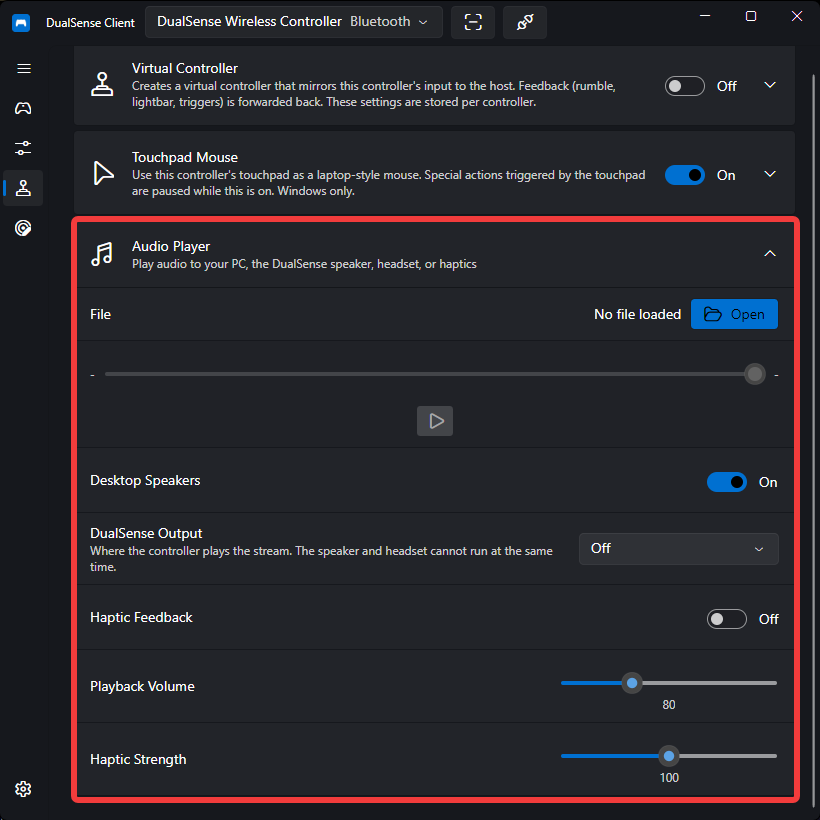

# Audio Playback

DualSense Client can play the loaded audio file to any combination of outputs:

1. **Desktop speakers** — your normal system output
2. **DualSense speaker or headset** — the controller's built-in speaker, or headphones plugged into its jack (mutually exclusive)
3. **Controller haptics** — audio rendered as haptic feedback inside the grips

Each output is toggled independently, so the current file can play on the desktop, through the controller, and through the haptics at the same time.

## Audio Player

Open the **Emulation** page and expand **Audio Player**.

## How It Works

- **Haptic audio over Bluetooth** is Opus-encoded specifically for the controller's haptic channels
- **USB audio** uses the controller's standard audio endpoint

!!! note
    With a **DS5Dongle**, USB audio is carried by the bridge. Use
    **Customization → Dongle Configuration** to choose the microphone and speaker routes and
    to configure volume locking. See the [DS5Dongle Bridge guide](dongle.md#dongle-configuration).

## Controls

- **File** — open an audio file (mp3, wav, flac, …) via the **Open** button. The file name, duration, position, and a seek bar with play/pause are shown in the transport row.
- **Outputs**
    - **Desktop Speakers** toggle — when on, audio plays through the PC.
    - **DualSense Output** selector — `Off`, `Speaker` (controller's built-in speaker), or `Headset` (headset jack). Speaker and headset are mutually exclusive and cannot run at the same time.
    - **Haptic Feedback** toggle — when on, the audio also drives the haptic actuators.
- **Playback Volume** — 0 – 255 for the controller speaker/headset path.
- **Haptic Strength** — 0 – 200% for the vibration intensity when haptics are enabled.

!!! note
    Haptic playback works best with sound effects and music with strong bass — the haptics are essentially two high-quality actuators, one per grip. The controller outputs are only usable when a controller is connected.

!!! note
    The per-controller **Software Volume Scale** under **Customization → Audio Forwarding** also applies to the audio player. It is shared with forwarded audio and special-action sounds; `1x` leaves the audio unchanged, and values above `1x` are soft-limited to prevent clipping.

Audio played by other applications can also be forwarded to the controller's speaker or headset. That is configured separately under [Audio Forwarding](virtual-controller.md#audio-forwarding).

## Microphone

A virtual DualSense or DualShock 4 can also expose the physical controller's microphone to the PC, so games and voice-chat applications can record from the virtual controller like any other microphone. This requires the physical controller to be connected over **Bluetooth** — over USB the controller's own audio device already provides the microphone. Virtual controller emulation is currently Windows-only.

| Virtual controller | Microphone format |
| ------------------ | ----------------- |
| DualSense          | 48 kHz stereo     |
| DualShock 4        | 16 kHz mono       |

The controller's microphone is mono, so the virtual DualSense duplicates it to both stereo channels. Xbox 360 emulation has no microphone endpoint.

Configure the microphone under **Customization → Audio Forwarding → Microphone**:

- **Route** — `Auto` uses the controller's built-in microphone, or its headset microphone when one is plugged in (the default). `Built-in` always uses the built-in microphone. `Headphone` always uses the headset microphone. `Disabled` turns the controller microphone off.
- **Level** — 0 – 100% (default 100%). Maps to the controller's own microphone volume.

The section is shown whenever a DualSense is connected. The route and level apply over both USB and Bluetooth, independently of emulation; they configure the controller's own microphone for applications that use its audio device directly. Stored values are kept while it is hidden.

Over Bluetooth, the **Microphone passthrough** switch under [Emulation → Virtual Controller → Passthroughs](virtual-controller.md#host-feedback) is the master switch for feeding the physical microphone into the virtual controller. It applies live, without recreating the virtual device. Switching it off silences the virtual microphone and stops the physical controller's microphone stream immediately; switching it back on resumes the stream while the recording application keeps the endpoint open. The route's `Disabled` option is an additional off switch for the physical microphone itself.

!!! note
    The controller microphone stream runs only while an application is recording from the virtual controller's microphone. Closing the recording application stops the stream, and no microphone traffic is sent while nothing is recording.

!!! tip
    Hide the physical controller while using the virtual microphone — see [Controller Hiding](controller-hiding.md). Otherwise, applications that open the physical controller directly can misread its microphone packets as gamepad input.
