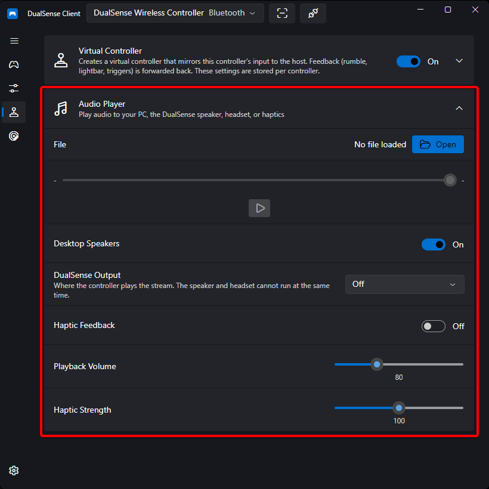

# Audio Playback

DualSense Client can play the loaded audio file to any combination of outputs:

1. **Desktop speakers** — your normal system output
2. **DualSense speaker or headset** — the controller's built-in speaker, or headphones plugged into its jack (mutually exclusive)
3. **Controller haptics** — audio rendered as haptic feedback inside the grips

Each output is toggled independently, so the current file can play on the desktop, through the controller, and through the haptics at the same time.

## Audio Player

Open the **Emulation** page and expand **Audio Player**.

## How It Works

- **Haptic audio over Bluetooth** is Opus-encoded specifically for the controller's haptic channels
- **USB audio** uses the controller's standard audio endpoint

## Controls

- **File** — open an audio file (mp3, wav, flac, …) via the **Open** button. The file name, duration, position, and a seek bar with play/pause are shown in the transport row.
- **Outputs**
    - **Desktop Speakers** toggle — when on, audio plays through the PC.
    - **DualSense Output** selector — `Off`, `Speaker` (controller's built-in speaker), or `Headset` (headset jack). Speaker and headset are mutually exclusive and cannot run at the same time.
    - **Haptic Feedback** toggle — when on, the audio also drives the haptic actuators.
- **Playback Volume** — 0 – 255 for the controller speaker/headset path.
- **Haptic Strength** — 0 – 200% for the vibration intensity when haptics are enabled.

!!! note
    Haptic playback works best with sound effects and music with strong bass — the haptics are essentially two high-quality actuators, one per grip. The controller outputs are only usable when a controller is connected.

Audio played by other applications can also be forwarded to the controller's speaker or headset. That is configured separately under [Audio Forwarding](virtual-controller.md#audio-forwarding).
