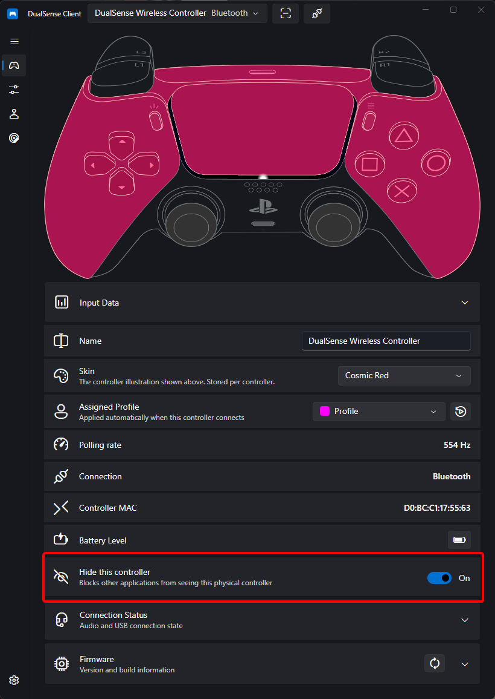

# Controller Hiding

When you use [virtual controller emulation](virtual-controller.md), games may see **two** controllers — the real one and the emulated one — causing double inputs in menus and gameplay. Controller Hiding solves this by making the physical controller unusable to other applications while DualSense Client keeps full access to it.

## Requirements

=== "Windows"

    - [HidHide](https://github.com/nefarius/HidHide) installed once
    - No extra configuration in the HidHide UI

=== "Linux"

    - The Linux hiding helper installed once (root)
    - A desktop using systemd and udev
    - Linux 6.12 or newer for hide/unhide without reconnecting the controller; older kernels use a HID-driver rebind fallback
    - Start DualSense Client through the installed application menu entry or `/usr/libexec/dualsenseclient/launch`

The Linux helper creates a `dualsenseclient` group, a small root daemon, a udev rule, and a setgid launcher. The GUI stays unprivileged; only the helper performs privileged device changes.

## How It Works

- Each controller has its own **Hide this controller** toggle on the **Device Info** page.
- When hidden, other applications can no longer open or read the physical controller's `hidraw`, gamepad, motion, joystick, or legacy mouse nodes.
- DualSense Client keeps its own HID handle, so monitoring, lighting, profiles, triggers, and audio continue to work.
- The app **whitelists itself** through its launcher/group on Linux and through the HidHide whitelist on Windows.



## Typical Setup for Games

1. Install the hiding backend for your platform:
    - **Windows:** install [HidHide](https://github.com/nefarius/HidHide).
    - **Linux:** run the helper installer once, then start the app from the application menu or the launcher.
2. Enable [virtual controller emulation](virtual-controller.md) with your preferred controller type.
3. Enable the hide toggle for the physical controller on its **Device Info** page.
4. Launch your game — it now uses only the virtual controller, with rumble and trigger feedback still reaching your hands.

!!! tip
    If a game misbehaves after hiding (for example it cannot see the controller at all), toggle the hide switch off again first — then check that the game is reading the virtual device rather than the physical one.

!!! tip
    On Windows, hiding can be automated per program with an [auto profile rule](auto-profiles.md#creating-a-rule). Auto Profiles remain Windows-only; on Linux use the per-controller toggle.

## Linux Setup

The helper is a **separate release asset**, not part of the app archive. Download `DualSenseClient-linux-hiding.tar.gz` from the same release as the app, then:

```bash
tar -xzf DualSenseClient-linux-hiding.tar.gz
sudo ./DualSenseClient-linux-hiding/install-dualsense-hiding.sh --app-path /path/to/DualSenseClient.AppImage
```

The installer creates the `dualsenseclient` group, installs the helper and launcher under `/usr/libexec/dualsenseclient/`, installs the systemd socket/service and the udev rules, and reloads udev. It canonicalizes `--app-path`, rejects relative paths and binaries writable by group/other users, and writes the result to `/etc/dualsenseclient/app-path`; the launcher reads that fixed root-owned path instead of accepting an arbitrary program. The `--app-path` argument also writes an application-menu entry.

The release helper is built for x86_64 Linux with glibc 2.35 or newer (Ubuntu 22.04, Debian 12, or newer).

For a source checkout, build the same asset with:

```bash
uv run python scripts/build_linux_hiding.py --output /tmp/dualsense-hiding-build
sudo /tmp/dualsense-hiding-build/install-dualsense-hiding.sh --app-path /path/to/DualSenseClient
```

Start DualSense Client through that menu entry or:

```bash
/usr/libexec/dualsenseclient/launch
```

If you start the app directly without the launcher, the hiding row explains that the backend is unavailable because the app does not have the `dualsenseclient` group.

### Linux Behavior and Limits

- **Hotplug works:** a controller that was hidden stays hidden when it reconnects, and the app reopens it automatically because it has the group.
- **Older kernels:** without `HIDIOCREVOKE` (Linux 6.12+), the helper rebinds the HID driver to revoke existing handles. The controller briefly reconnects and its lights/triggers are reapplied by the app. Manual hide/unhide on those kernels can therefore cause a visible reset.
- **Enumeration:** access is denied, but the device may still appear in some controller lists as an unusable entry. Unlike HidHide, this is not a kernel filter driver, so it does not remove the device from udev/sysfs.
- **Touchpad and media keys:** hiding the whole controller also hides its touchpad mouse and headset-jack keys while hidden. Unhide to use them again.
- **libusb:** applications that bypass hidraw/evdev and use raw USB access may still see the controller on distributions that grant usbfs access. This is not blocked in the current version.
- **Simultaneous transports:** if the same controller is connected over USB and Bluetooth at the same time, every matching HID instance is hidden and restored together.
- **Fail-open:** if the app exits or crashes, the helper restores the saved ownership, mode, and ACLs. If the helper itself cannot run, the cleanup script restores standard controller permissions and udev re-applies the seat ACL. The controller is visible again.
- **Updates:** if a new app version needs a newer helper protocol, hiding becomes unavailable and the app explains that the helper must be installed or updated. Re-run the installer after updating. The helper is not auto-updated.
- **Troubleshooting:** see [Linux hiding is unavailable](../troubleshooting.md#linux-hiding-is-unavailable).

To uninstall the Linux helper, run `uninstall-dualsense-hiding.sh` with `sudo` from the same build or release directory as the installer. It stops the service, runs the crash-cleanup path to restore any hidden controller, removes the files and rules, and deletes the group only if the installer created it and it has no members.

## Windows Setup

1. Install [HidHide](https://github.com/nefarius/HidHide) once. No extra configuration is needed in its own UI.
2. Open the physical controller's **Device Info** page and enable the hide toggle.
3. The app adds itself to the HidHide whitelist automatically, so it keeps seeing the hidden controller while games do not.
