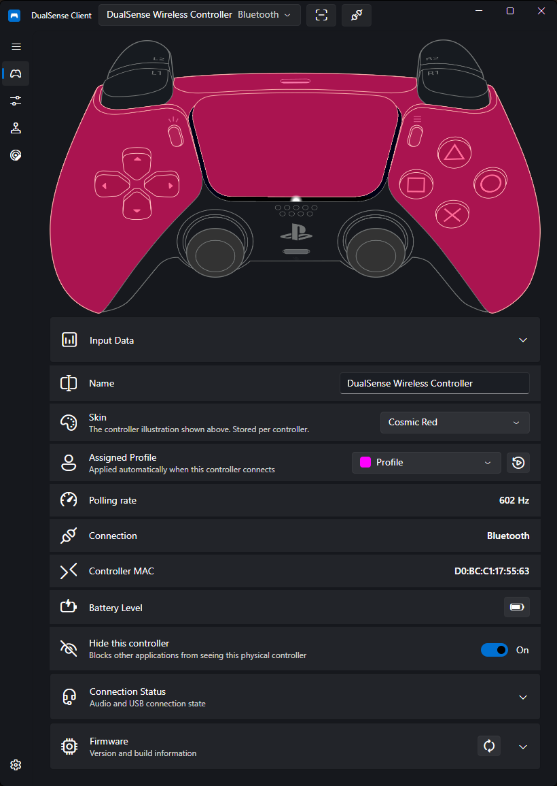

# Device Information

The **Device Info** page shows everything the controller reports about itself and hosts the live input view. Select the active controller from the title-bar picker — all sections on this page reflect that controller.

## Controller Identification

- **Controller illustration** — a skin-tinted visualization of the connected controller, including live button, stick, trigger, and touchpad input.
- **Name** — rename the selected controller. The name is stored per controller and used in the title-bar picker, tray menu, and notifications.
- **Skin** — choose the illustration skin used for the visualization above. Skins are stored per controller.
- **Assigned profile** — choose which profile the controller uses. The profile is applied automatically when the controller connects; the **Re-apply profile** button pushes its settings to the controller again. See [Profiles](profiles.md).
- **Connection** — the current transport: USB or Bluetooth.
- **Controller MAC** — the Bluetooth MAC address, or `-` when the controller does not report one. Profile and controller identity fall back to the HID path where needed.
- **Polling rate** — how often input reports are arriving from the controller.

## Input Data

The **Input Data** expander shows the live values behind the illustration: L2/R2 travel, stick axes, touch positions, and gyroscope/accelerometer readings. See [Input Monitoring](input-monitor.md) for details.

## Battery

- Current **battery level** (percentage when known)
- **Power state**, such as charging or discharging

A toggle lets you switch between the percentage text and a battery icon. The tray icon can also show the active controller's battery — see [Settings](settings.md#window-tray).

## Controller Hiding

The **Hide this controller** row blocks other applications from seeing the physical controller. It is available on Windows and requires the [HidHide driver](controller-hiding.md); when the driver is missing, the row explains that it is not installed.

## Connection Status

Live status indicators show whether:

- Headphones are plugged into the controller's jack
- A microphone is plugged in
- The microphone is muted
- USB carries data and/or power only

## Firmware & Hardware

Use the **Refresh** button in the Firmware header to re-read all values from the controller:

- **Firmware versions** — main, SBL, DSP, and MCU/Spider DSP
- **Model revision**, hardware version, and hardware generation
- **Build date** and **Build time** of the installed firmware

---

Controller hiding lives on this page; virtual controller emulation has its own [Emulation page](virtual-controller.md). The title-bar Scan/Disconnect controls are described in [Settings](settings.md#other-window-controls).
