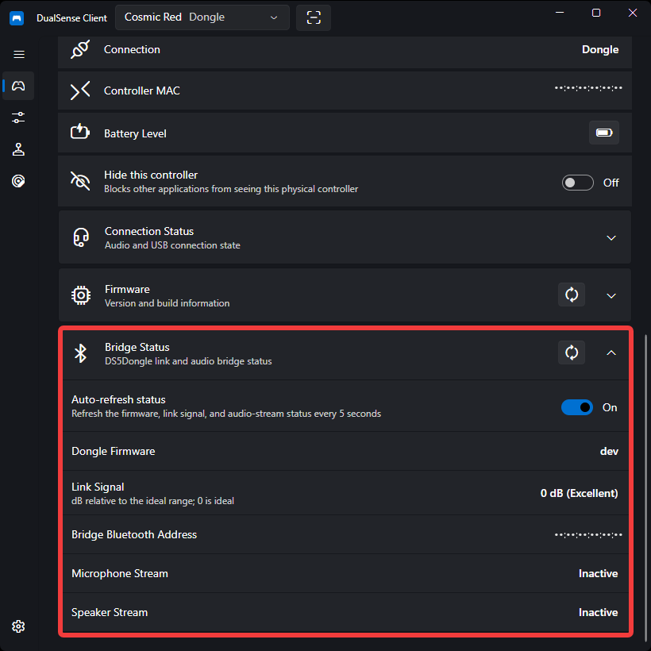
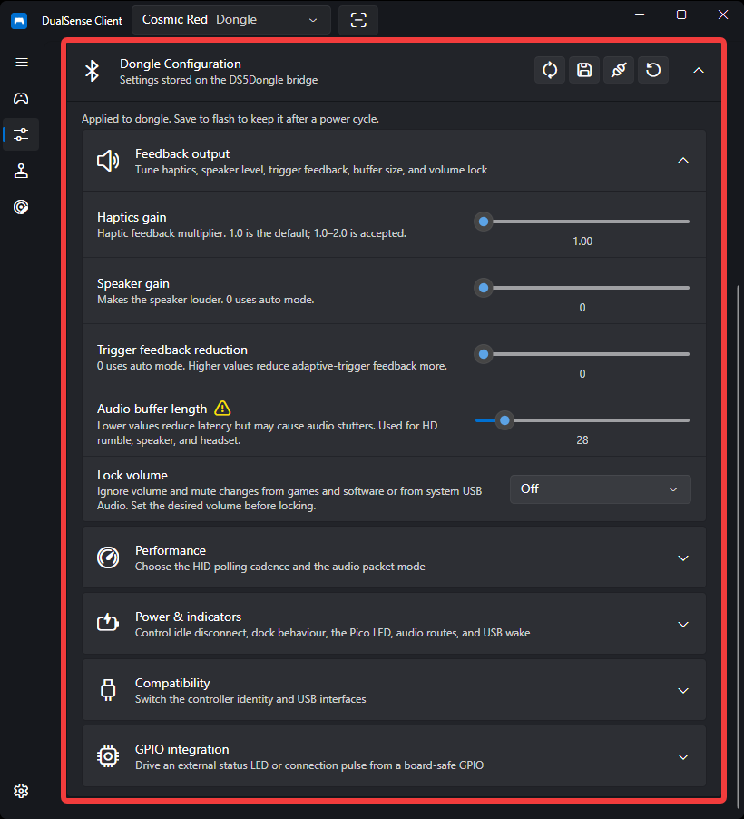

# DS5Dongle Bridge

The **DS5Dongle** is a USB Bluetooth bridge for the DualSense. The host sees a wired
DualSense controller, while the bridge maintains the Bluetooth link to the controller.

DualSense Client detects the bridge automatically. The transport remains **USB** — report
formats, raw input, and audio use the wired path — but the controller picker and
**Device Info** page label it **Dongle** to distinguish it from a direct USB connection.

!!! note
    The bridge is not a separate controller model. A dongle connected to a DualSense Edge
    is still presented as a DualSense Edge, with the same Edge buttons and paddles.

!!! note "Firmware source"
    DS5Dongle support is tracked against the official
    [DualSenseClient/DS5Dongle](https://github.com/DualSenseClient/DS5Dongle) repository.
    The latest commit there is the supported firmware revision for this client. Forked or
    unmerged firmware changes may work, but they are not tracked or tested here.

## Requirements

- A DS5Dongle bridge with firmware that exposes its status and configuration endpoints.
- The controller paired to the bridge. The host does not need to pair with the controller.
- No extra driver on Windows or Linux; the bridge uses the standard USB HID and audio stack.

## Bridge Status

Select the dongle in the title-bar controller picker, then open **Device Info** and expand
**Bridge Status**.

| Field | Meaning |
| ----- | ------- |
| **Dongle Firmware** | Firmware version reported by the bridge. |
| **Link Signal** | Bluetooth link quality in dB relative to the ideal range. `0` is ideal; larger negative values are weaker. `-128` means no reading. |
| **Bridge Bluetooth Address** | Bluetooth address the controller is paired to. |
| **Microphone Stream** | Whether the bridge is actively streaming the controller microphone. |
| **Speaker Stream** | Whether the bridge is actively driving the controller speaker or headset. |

The link signal is classified as **Excellent** (`>= -5 dB`), **Good** (`>= -15 dB`),
**Fair** (`>= -25 dB`), or **Weak** below that. Positive values are treated as invalid.

### Auto-refresh

**Auto-refresh status** re-reads the bridge every five seconds while **Device Info** is
visible and a dongle is selected. It is off by default and the choice is saved.

The bridge firmware returns its cached link signal and starts a new measurement in the
background. The first read after connecting can therefore report `0`; the page performs a
delayed read after opening, and auto-refresh keeps the value current. Turning the
controller on before opening the page gives the most useful reading.

The **Refresh** button in the Bridge Status or Firmware header also re-reads the bridge
status.

## Dongle Configuration

Open **Customization → Dongle Configuration**. The section appears below **Audio
Forwarding** when a dongle is selected.

Edits are applied to the bridge automatically after a short delay. They stay in RAM until
you use **Save to Flash**, which persists them across bridge reboots.

| Action | What it does |
| ------ | ------------ |
| **Read** | Re-reads the configuration from the bridge. |
| **Save to Flash** | Applies pending edits and persists the current configuration. |
| **Reconnect USB** | Applies pending edits and re-enumerates the bridge so USB-descriptor changes take effect. |
| **Reset to Defaults** | Restores the app's defaults for the exposed settings and saves them to flash. |

Some changes need a USB reconnect before they take effect. The page shows a warning when
this applies; the affected settings are polling rate, controller mode, USB serial number,
keyboard interface, and USB wake.

### Feedback output

| Setting | Description |
| ------- | ----------- |
| **Haptics gain** | Haptic feedback multiplier. `1.0` is the default; the accepted range is `1.0–2.0`. |
| **Speaker gain** | Makes the controller speaker louder. `0` uses automatic gain. |
| **Trigger feedback reduction** | `0` uses automatic mode; higher values reduce adaptive-trigger feedback. |
| **Audio buffer length** | Controller-side audio buffer (`16–128`). Lower values reduce latency but may cause audio stutters. |
| **Lock volume** | Selects which volume and mute changes the bridge ignores. |

If the audio buffer length is below `32` and **Single packet mode** is off, a warning icon
appears next to the buffer setting. Enable single packet mode if audio stutters.

### Lock volume modes

| Mode | Behavior |
| ---- | -------- |
| **Off** | Accept volume and mute changes from every source. |
| **Games & software** | Ignore volume and mute changes in HID output reports. System USB Audio controls still work. |
| **System volume (UAC)** | Ignore volume and mute changes through USB Audio, including the Windows device volume. Game and software HID controls still work. |

Both ignore modes cover the speaker, headphones, and microphone. Set the desired volume and
mute state before enabling a lock mode. USB Audio reads return the last accepted values, and
the Windows slider may still move because the host can cache its own request. Ignoring UAC
changes does not stop a game or the Windows per-application mixer from attenuating audio
samples before they reach the bridge.

### Performance

| Setting | Description |
| ------- | ----------- |
| **Polling rate** | HID report cadence: `250 Hz`, `500 Hz`, `1000 Hz`, or **Real-time**. `500 Hz` is recommended. Real-time forwards each report immediately and may cause gyro jitter. |
| **Single packet mode** | Sends one audio frame per Bluetooth packet instead of two. Recommended when the audio buffer length is below `32`. |

### Power & indicators

| Setting | Description |
| ------- | ----------- |
| **Inactive time** | Idle minutes before the bridge disconnects the controller. `0` disables the timeout. |
| **Disconnect on dock** | Drops the Bluetooth link when the controller is placed on a charger or dock. |
| **Disable Pico LED** | Turns off the always-on Pico LED. It still blinks when the controller battery is low. |
| **Wake host on PS press** | Wakes the host when the PS button is pressed. USB stays continuously connected while enabled. |
| **Microphone** | Microphone route: **Auto**, **Built-in**, **Headphone**, or **Disabled**. |
| **Speaker / headset** | Speaker route: **Auto**, **Built-in**, **Headphone**, or **Disabled**. |

Older firmware also exposes legacy **Disable microphone**, **Disable speaker**, and **Enable
PS shortcut** toggles instead of the modern route and shortcut settings.

### Compatibility

| Setting | Description |
| ------- | ----------- |
| **Controller mode** | USB identity presented by the bridge: **DS5**, **DSE** (DualSense Edge), or **Auto**. Auto matches the connected controller. |
| **Enable USB serial number** | Exposes the USB serial-number descriptor. Requires a USB reconnect. |
| **Enable keyboard interface** | Exposes the USB keyboard interface used by shortcut actions. Requires a USB reconnect. |

The bridge may expose keyboard and consumer-control HID interfaces when the keyboard
interface or wake feature is enabled. DualSense Client only opens the generic-desktop
gamepad/joystick interface, so these extra interfaces do not appear as phantom controllers.

### GPIO integration

| Setting | Description |
| ------- | ----------- |
| **Status GPIO pin** | Pico 2 W GPIO `2–22` or `26–28`; **Disabled** turns the output off. |
| **Status GPIO mode** | **High while connected**, or a **200 ms connect pulse**. |

### Firmware layouts

The configuration page supports current v5 firmware with the 24/25-byte layout and the
original 19-byte legacy layout. Firmware versions older than v5 and intermediate 20–23-byte
v5 layouts are rejected rather than guessed at. Update the bridge firmware if the page
reports that the configuration report is unavailable.

## Related Pages

- [Device Information](device-info.md) — bridge status and controller details
- [Audio Playback](audio.md) — play audio through the controller
- [Emulation](virtual-controller.md) — create a virtual controller for games
- [Troubleshooting](../troubleshooting.md) — connection and configuration problems
