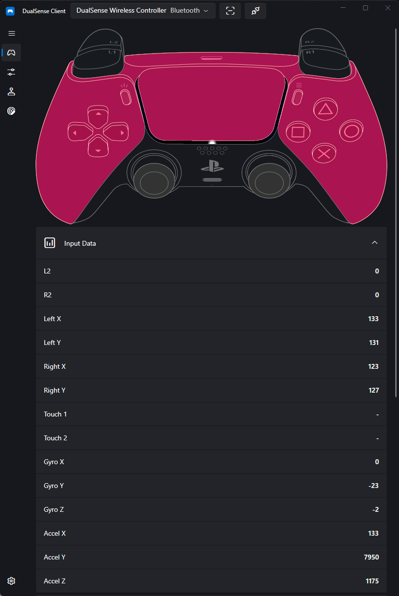

# Input Monitoring

Live input is shown on the **Device Info** page. The controller illustration updates in real time, and the **Input Data** expander lists the current values for the sticks, triggers, touchpad, and motion sensors.

## Live Controller View

- **Buttons** — every button on the controller lights up on the illustration as it is pressed.
- **Sticks** — the stick positions are drawn on the illustration.
- **Triggers** — L2/R2 travel is reflected on the illustration.
- **Touchpad** — touch positions and clicks are shown on the touchpad.
- **Edge controls** — on a DualSense Edge, the FnL, FnR, L4, and R4 indicators light when pressed.

With several controllers connected at once, use the **controller picker** in the title bar to switch which device is being monitored.

## Input Data

Expand **Input Data** to see the live numeric values:

- L2 and R2 trigger positions
- Left and right stick X/Y axes
- Touch 1 and Touch 2 positions
- Gyroscope X/Y/Z
- Accelerometer X/Y/Z

The controller's current **polling rate** is shown in its own row on the Device Info page.

!!! tip
    Input monitoring is handy for diagnosing stick drift, verifying trigger travel, or confirming that button prompts map correctly in games.

## Related Controls

- **Rumble and adaptive trigger output tests** are on the [Customization page](rumble-and-triggers.md).
- **Audio playback** is on the [Emulation page](audio.md#audio-player).
