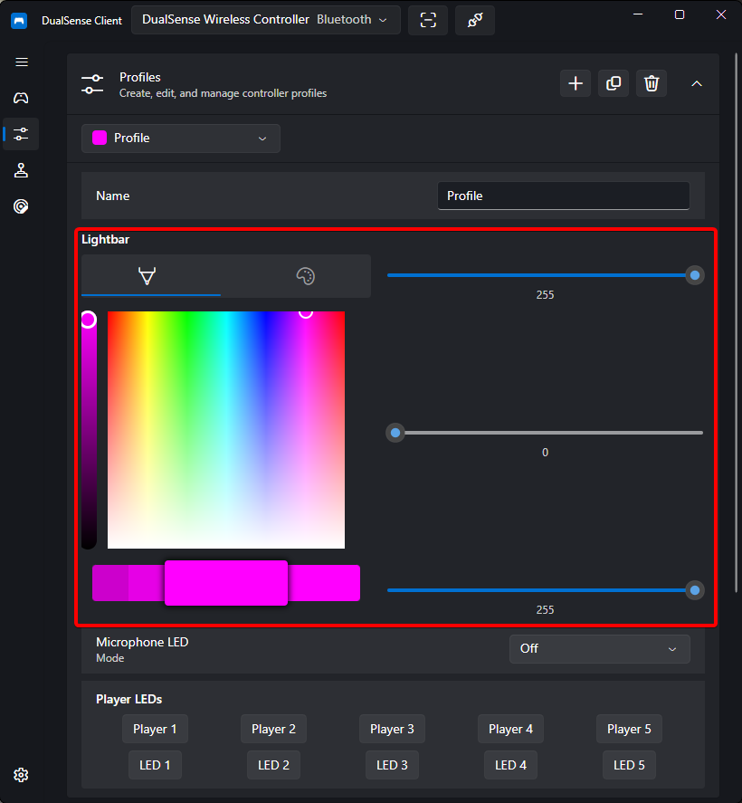
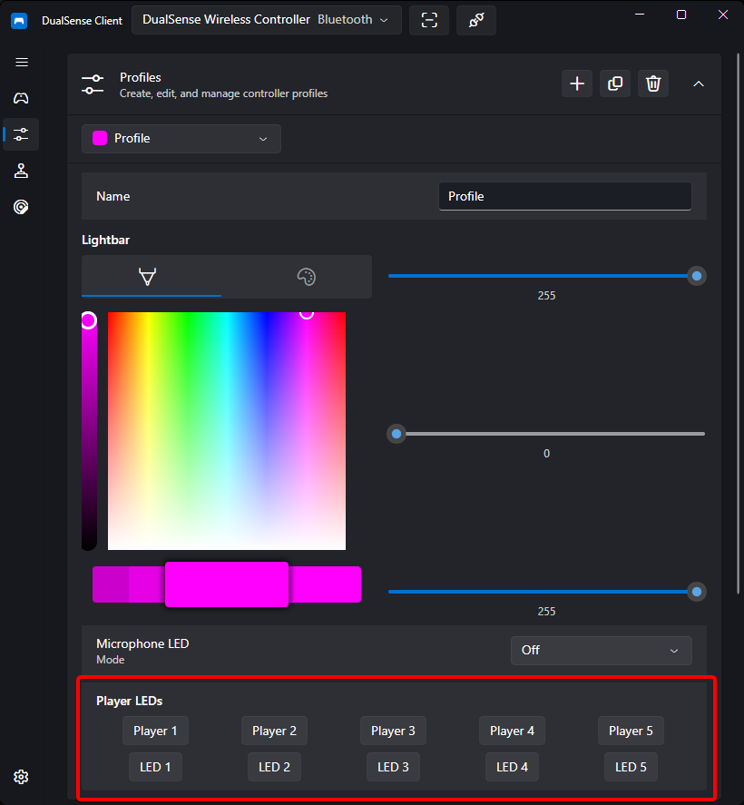

# Light Control

DualSense Client gives you full control over the controller's lighting: the RGB lightbar, the five player LEDs, and the microphone LED. The controls live in the profile editor under **Customization → Profiles**.

## Lightbar

The lightbar has a **mode** that decides what it shows, plus a shared **brightness** slider. Brightness runs from 0 to 100 and scales the color the mode produces in software, so 0 turns the lightbar off. Each profile stores its own mode, colors, and brightness.

!!! note "Passthrough takes over"
    When a virtual **DualSense** forwards the host's lighting, **Forward lightbar** suspends the profile's lightbar effect until it is turned off, and **Forward player LEDs** suppresses the profile's player-LED effects (Battery and Audio Reactive). With a virtual DualShock 4 the game's lightbar is still forwarded, but it does not suspend the profile effect. Passthroughs are configured under **Emulation → Virtual Controller → Passthroughs**.

    To keep the profile in control instead, enable **Override virtual controller lights** below the profile name. While it is on, the profile's lightbar, player LEDs, and microphone LED are applied over the forwarded output; special actions still take priority.

!!! note "Special Actions and manual edits"
    [Special Actions](special-actions.md) always win while they are applying light effects. Editing the lightbar directly on the [Device Info](device-info.md) page stops the effect until the profile is applied again.

!!! tip
    Put the look you want in a [profile](profiles.md) and assign it to the controller on the Device Info page, so it is applied automatically whenever that controller connects.

### Single Color

The lightbar shows one fixed color:

- **Color picker** — pick a color visually, with a spectrum and a palette of standard colors
- **Sliders** — fine-tune the red, green, and blue channels
- **Profile color swatch** — the selected profile's color is shown in the profile list and dropdown

### Multi Color

The lightbar blends through a palette of colors:

- **Palette** — the colors to cycle through; a single entry keeps the lightbar on that color
- **Speed** — how quickly the palette cycles, from slow to fast
- **Random color** — picks each segment's palette color at random instead of following the palette order

### Breathing

The lightbar fades smoothly between two intensity levels:

- **Minimum intensity** / **Maximum intensity** — the dimmest and brightest points of the breath, as 0–100%
- **Speed** — how fast one breath cycle runs
- **Random color** — uses a new hue for each breath instead of the profile color

### Strobing

The lightbar flashes on and off using the profile color:

- **Speed** — flash rate, from slow to fast

### Battery

The lightbar shows the controller's charge level:

- **Discharging** — the lightbar shows the color of the current charge band, one of ten level colors from empty to full
- **Charging** — the lightbar shows the current charge band color
- **Animate lightbar while charging** — optional; crossfades through all ten level colors while charging. Expand the row to set the crossfade **Speed**.
- **Animate player LEDs while charging** — optional; runs a single LED chase across the player LEDs while charging. Expand the row to set the chase **Speed**. Only available on Generation 0x02 / 0x03 hardware.
- **Show battery level on player LEDs** — optional; lights one to five player LEDs as the charge rises. Only available on Generation 0x02 / 0x03 hardware. Enabling it clears the profile's player LED layout and hides the Player LEDs section while Battery mode is selected; turn it off to set the player LEDs again. If both player-LED options are on and the controller is charging, the chase takes priority.

### Audio Reactive

The lightbar follows the audio being forwarded to the controller:

- **Quiet color** / **Medium color** / **Loud color** — the color shown at each audio level; the lightbar blends between them as the level rises and falls
- **Sensitivity** — scales the audio level before it is mapped to a color
- **Show audio level on player LEDs** — optional; lights one to five LEDs in five even steps as the level rises, from one LED at quiet levels to all five at loud levels. Only available on Generation 0x02 / 0x03 hardware. Enabling it clears the profile's player LED layout and hides the Player LEDs section while Audio Reactive mode is selected; turn it off to set the player LEDs again.

!!! note "Audio forwarding must be active"
    Audio Reactive follows the audio stream being forwarded to the controller, whichever forwarding source is selected; audio forwarding must be active. Enable it in **Customization → Audio Forwarding** (see [Emulation](virtual-controller.md#audio-forwarding)); with no audio being forwarded, the lightbar stays at the quiet color.

## Player LEDs

Toggle each of the five player indicator LEDs individually, or use the **Player 1 – 5** presets. This is the same set of lights used on the PS5 to show player slots (1–4 plus the extra LED).

!!! note "Depends on controller generation"
    The available controls depend on the connected controller's hardware generation (see [Firmware & Hardware](device-info.md#firmware-hardware)):

    - **Generation 0x02 / 0x03** — full support. The profile shows both the five player presets (**Player 1 – 5**) and five individual toggles (**LED 1 – 5**).
    - **Generation 0x04** — **mirrored only**. Only the five presets are offered; the individual LED toggles are hidden. You can verify the generation on the Device Information page.
    - When no controller is connected or its firmware info is not yet valid, the view falls back to presets only.

## Microphone LED

Configure how the microphone LED behaves:

| Mode  | Behavior                        |
| ----- | ------------------------------- |
| Off   | The mic LED stays off           |
| On    | The mic LED stays lit           |
| Pulse | The mic LED pulses continuously |

---

Edits to the profile assigned to the selected controller are applied immediately. Profiles are saved automatically — assign one on the [Device Info](device-info.md) page to apply it on connection.
