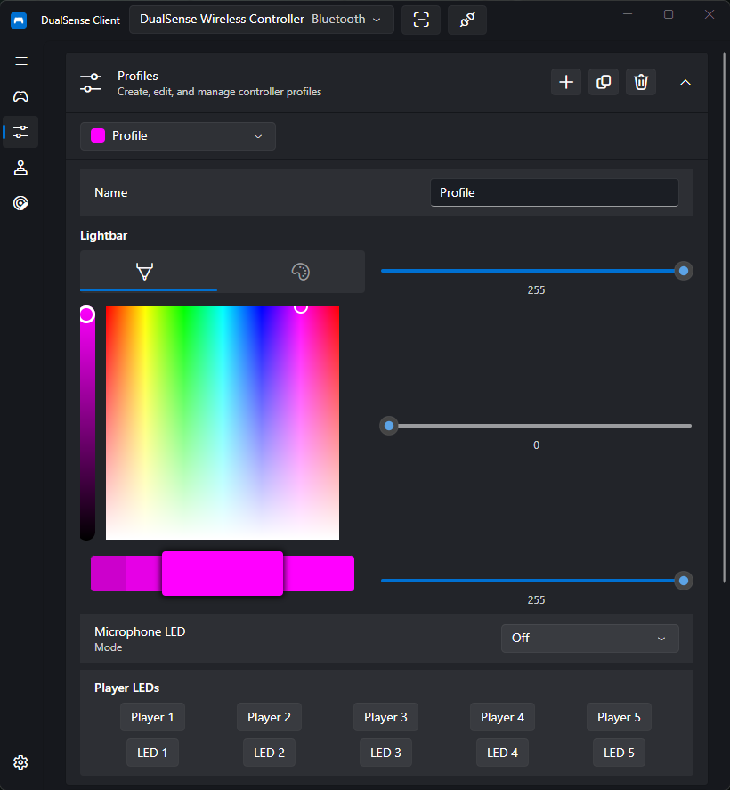

# Profiles

Profiles store a controller's lighting settings: the lightbar color, microphone LED mode, and player LEDs. They are global, and each controller can be assigned one profile that is applied automatically every time it connects.

## Creating and Editing a Profile

Open **Customization → Profiles**. You can:

- **Create** a new profile with the **+** button
- **Duplicate** the selected profile to use as a starting point
- **Rename** it in the name field
- **Delete** it with the delete button

The profile editor contains the [lightbar and player LED controls](light-control.md). Select a profile from the dropdown to edit it.

Edits to the profile currently assigned to the selected controller are applied immediately. Profiles are saved automatically.

## Binding Profiles to Controllers

Assign a profile on the **Device Info** page under **Assigned Profile**. Each controller is identified by **MAC address**, with a device path fallback when the MAC is unavailable.

When an assigned controller connects, its profile is **applied automatically**. Use **Re-apply profile** on the Device Info page to push the assigned profile to the controller again.

!!! tip
    Assigning by MAC address means you can own multiple controllers with different lighting setups — for example one per player — and each gets its own look the moment it connects.

## Switching Profiles Automatically

To change profiles based on the focused program instead of the connected controller, use [Auto Profiles](auto-profiles.md) — for example a different profile (and virtual controller mode) per game.
