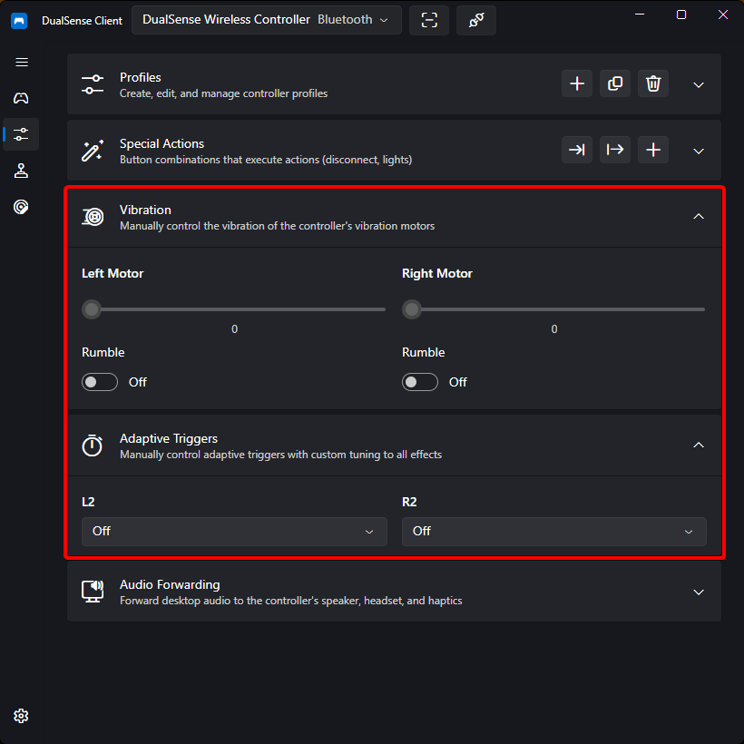

# Rumble & Triggers

Test and configure the controller's output motors on the **Customization** page: the vibration motors and the adaptive triggers for L2/R2.

## Vibration

Expand **Vibration** to control each motor independently:

- **Left motor** — low-frequency, heavier rumble
- **Right motor** — high-frequency, lighter rumble

Enable **Rumble** for a motor and adjust its **Strength** slider from 0 – 255. Changes are sent to the controller immediately.

## Adaptive Triggers

Expand **Adaptive Triggers** to tune L2 and R2 separately. Choose a mode from the dropdown, then adjust the sliders for that mode.

| Mode                | Behavior                                                                 |
| ------------------- | ------------------------------------------------------------------------ |
| **Off**             | No effect; the trigger moves freely.                                     |
| **Feedback**        | Constant resistance beyond the start position.                           |
| **Weapon**          | Resistance between the start and end positions.                          |
| **Vibration**       | Vibration beyond the start position.                                     |
| **Bow**             | Weapon-like resistance with a snap-back force.                           |
| **Galloping**       | Rhythmic galloping oscillation.                                          |
| **Machine**         | Vibration oscillating between two amplitudes.                            |
| **Slope Feedback**  | Resistance that changes gradually from the start strength to the end strength. |

The **Bow**, **Galloping**, and **Machine** modes are unofficial effects and may be removed by a future controller firmware update.

### Parameters

| Slider          | Range      | Applies to                                                     |
| --------------- | ---------- | -------------------------------------------------------------- |
| **Start**       | 0 – 9      | All modes except Off. Max 9 for Feedback/Vibration, 8 for Galloping/Machine/Slope, 7 for Weapon/Bow. Weapon starts at 2 or higher. |
| **End**         | Start+1 – 9 | Weapon, Bow, Galloping, Machine, Slope Feedback. Weapon/Bow cap at 8. |
| **Force**       | 0 – 8      | Feedback, Weapon, Vibration, Bow, Machine (0 – 7), Slope Feedback. |
| **Frequency**   | 0 – 255    | Vibration, Galloping, Machine.                                 |
| **Snap force**  | 0 – 8      | Bow.                                                            |
| **First foot**  | 0 – 6      | Galloping.                                                      |
| **Second foot** | 1 – 7      | Galloping; must be after the first foot.                        |
| **Amplitude B** | 0 – 7      | Machine.                                                        |
| **Period**      | 0 – 255    | Machine; oscillation period in tenths of a second.              |
| **End strength** | 0 – 8     | Slope Feedback.                                                 |

Start and end positions map to ten trigger zones, from the start of the pull (0) to the end (9). End must be after Start.

!!! tip
    These are the same effects available per program in [Auto Profiles](auto-profiles.md). Use the output test here to find settings you like before assigning them to a rule.
