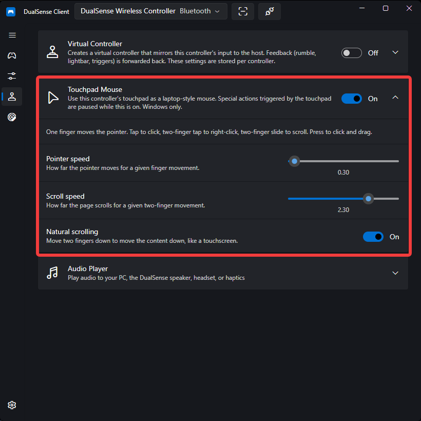

# Touchpad Mouse

The DualSense touchpad can double as a **Windows mouse**, turning the controller into a laptop-style trackpad for browsing, media apps, and launchers when no mouse is within reach — especially handy when you are using the PC from a couch. One finger moves the pointer, taps click, and two-finger gestures right-click and scroll.

!!! note
    Touchpad Mouse is **Windows-only**. On Linux the section is hidden and the feature stays inactive; the desktop already receives the controller's touchpad through the system input stack.

## Enabling It

1. Connect your controller
2. Open the **Emulation** page
3. Expand **Touchpad Mouse**
4. Turn on the switch in the expander footer

Settings are stored **per controller** and applied automatically whenever that controller connects. The feature works whether or not a virtual controller is active, and keeps working while the app is in the background.

The options below the switch stay disabled until the feature is on:

| Option                | Range      | Description                                                                                                            |
| --------------------- | ---------- | ---------------------------------------------------------------------------------------------------------------------- |
| **Pointer speed**     | 0.25 – 3.0 | How far the pointer moves for a given finger movement.                                                                 |
| **Scroll speed**      | 0.25 – 3.0 | How far the page scrolls for a given two-finger movement.                                                              |
| **Natural scrolling** | on/off     | Move two fingers down to move the content down, like a touchscreen. Off uses the standard Windows scrolling direction. |

## Gestures

| Gesture          | Action                                             |
| ---------------- | -------------------------------------------------- |
| One-finger slide | Moves the Windows pointer                          |
| One-finger tap   | Left click                                         |
| Touchpad press   | Left click — hold the button down and move to drag |
| Press + second finger | Hold the pad with one finger; move a second finger to drag |
| Two-finger tap   | Right click                                        |
| Two-finger slide | Scrolls vertically and horizontally                |

A tap is a quick touch and lift; sliding a finger only moves the pointer and does not click. While two fingers are on the touchpad without a press, the pointer stays still and a two-finger slide scrolls instead. A physical press clicks immediately, and keeping it held while you move drags. You can also keep one finger on the pad to anchor the press and drag with a second finger; while the pad is held, two-finger movement drags instead of scrolling.

## Touchpad Special Actions

While the touchpad drives the mouse for a controller, that controller's **touchpad-triggered special actions are paused**: swipe gestures and button combinations that include the touchpad button do not fire. Other button combinations keep working. Turning the feature off restores them. See [Special Actions](special-actions.md).

## Limitations

- **Elevated windows (UIPI)** — Windows blocks injected input from reaching apps running as administrator, so the pointer and clicks cannot reach an elevated window. If an elevated window takes focus in the middle of a drag, the button release can be blocked as well.
- **Windows pointer settings** — the injected movement goes through the Windows mouse speed and pointer-acceleration settings; the app's **Pointer speed** slider scales on top of them. If the pointer feels faster or slower than expected, check the Windows mouse settings.
- **Raw-input games** — games that read raw mouse input, including many first-person shooters, do not see the injected movement. Use the touchpad mouse for desktop navigation and couch use, not for game aiming.
