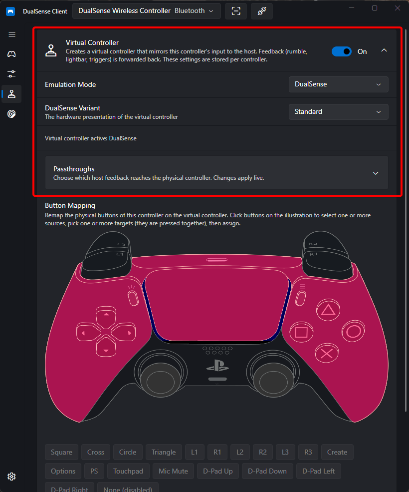
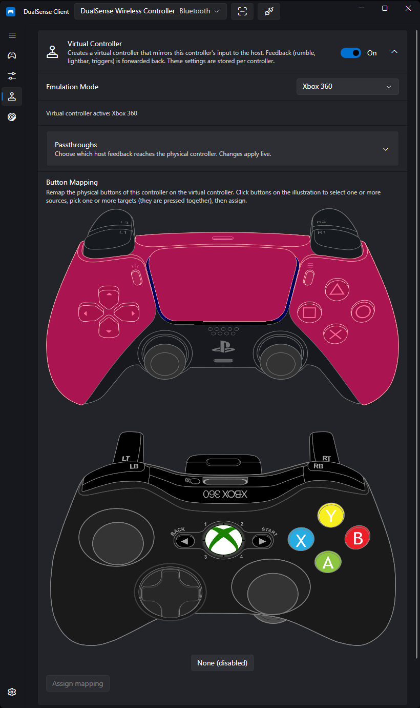
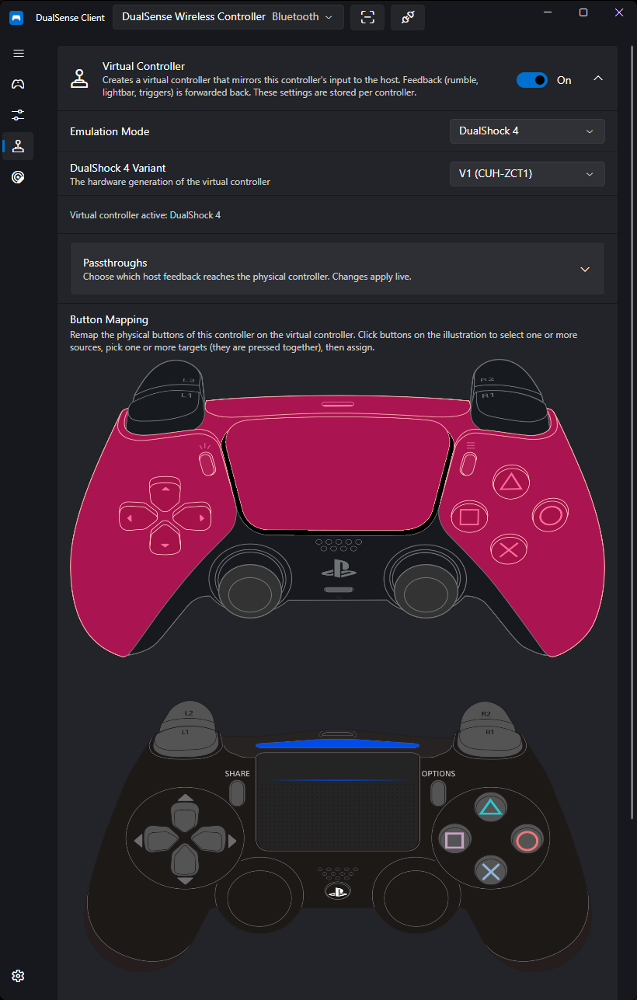
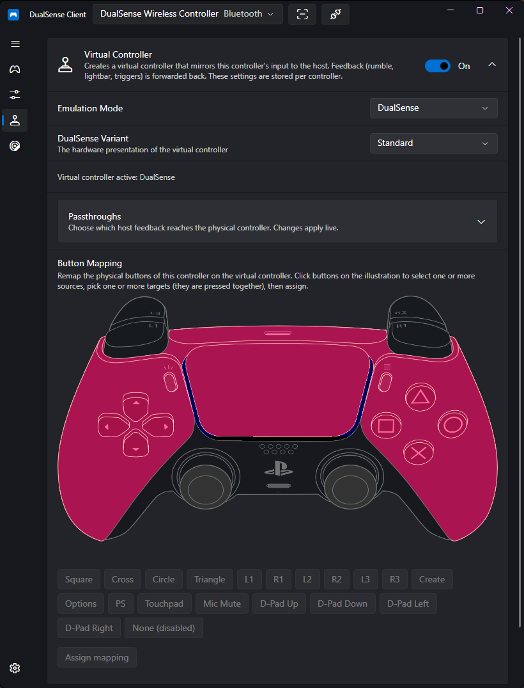
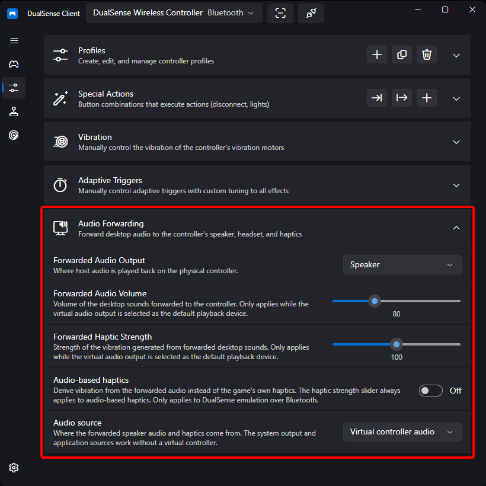

# Emulation

The **Emulation** page creates a **virtual controller** that mirrors your physical DualSense, letting games see whichever controller type they handle best.

!!! note
    Virtual controller emulation is currently **Windows-only**. The Emulation page is still visible on Linux, but the controls are disabled and no virtual device is created.

## Emulated Controller Types

| Type                         | Notes                                                |
| ---------------------------- | ---------------------------------------------------- |
| Xbox 360                     | The most widely supported type in PC games           |
| DualShock 4                  | Native PlayStation-style prompts in supporting games |
| DualSense (Standard or Edge) | Exposes haptics and adaptive triggers to the host    |

The virtual device **mirrors the physical controller's input**, while rumble, lightbar, and trigger feedback from the host is **forwarded back** to your physical controller. DualShock 4 emulation also offers a V1/V2 hardware variant; DualSense emulation offers Standard/Edge.

## Requirements

The app's built-in emulation engine attaches virtual devices through the **USB/IP driver**, so that is the only requirement:

=== "Windows"

    Install [usbip-win2](https://github.com/vadimgrn/usbip-win2)

=== "Linux"

    Virtual controller emulation is not yet supported on Linux. The `usbip` package will be needed once support is enabled.

If no virtual device appears after enabling emulation, see [Virtual Controller Does Not Appear](../troubleshooting.md#virtual-controller-does-not-appear).

## Enabling & Configuring

1. Connect your physical controller
2. Open the **Emulation** page
3. Turn on **Virtual Controller** and choose an emulation mode
4. Choose the hardware variant when the mode offers one

Settings are stored per controller and applied automatically on connection. To switch the emulation mode automatically per program, use [Auto Profiles](auto-profiles.md).

## Button Remapping

Each emulation mode has its own **mapping editor** where you can rewire physical buttons to different virtual outputs.

1. **Select source buttons** — click buttons on the illustrated controller. On a DualSense Edge you can also select the Edge chip buttons (FnL, FnR, L4, R4). Select several at once to create a combo; the summary shows what is selected and a **Clear** button resets it.
2. **Choose the target** — depending on the emulated controller:
    - **Xbox 360 / DualShock 4** — pick targets on the virtual-controller illustration (click to toggle). The kind of illustration follows the emulated type.
    - **DualSense** — pick targets from the combo list (multiple targets can be pressed together). **None (disabled)** creates a disabled binding that suppresses the source.
3. **Trigger output** — when a single L2 or R2 is the only source button, choose between **Full pull (analog 0 – 255)** and **Click flag only** (digital click) for the virtual trigger. Only available for DualShock 4 and DualSense emulation.
4. **Suppress solos** — when a combo is mapped, the solo presses of those buttons are muted while the combo is held. Uncheck to allow solos through.
5. Press **Assign** to save the binding. If the same source keys already have a binding, it is replaced. Each row shows the source → target summary with a **Delete** button.

Other mapping actions:

- The **bindings list** shows every rule; remove any with its delete button.
- **Reset to defaults** clears all custom bindings for the current emulation mode.

=== "Xbox 360"

    

=== "DualShock 4"

    

=== "DualSense"

    

If no mapping is desired, leave the editor empty — the default one-to-one mapping applies.

## Audio Forwarding

Host audio can be forwarded to your **physical controller's speaker or headset**, with volume and haptic-strength controls. These settings live under **Customization → Audio Forwarding**, not in the emulation section.

- **Forwarded Audio Output** — `Speaker` or `Headset`.
- **Forwarded Audio Volume** — 0 – 255.
- **Forwarded Haptic Strength** — 0 – 200.
- **Audio-based haptics** — derive vibration from the forwarded audio instead of the game's own haptics. The haptic-strength slider always applies to audio-based haptics. Only applies to DualSense emulation over Bluetooth.

### Audio Sources

Choose what feeds the forwarding from the **Audio source** dropdown:

- **Virtual controller audio** — audio a game plays through the virtual controller. The game must select the virtual controller's audio output.
- **System output (loopback)** — whatever plays on your system's default output device. Works without a virtual controller.
- **Specific application** (Windows 11) — capture only one application's audio, including its child processes. Works without a virtual controller.

For the specific-application source, choose the application from the list of programs currently playing audio or browse for its executable file. The sources are mutually exclusive, and you can switch between them while a game is running.

Audio forwarding works in any emulation mode, including off, for the system-output and specific-application sources. It can also be overridden per program in [Auto Profiles](auto-profiles.md).

## Audio Player

The **Audio Player** on this page plays audio files to your desktop, the controller speaker, headset, or haptics. See [Audio Playback](audio.md#audio-player).

## Status & Combining With Games

The **Emulation status** text shows the lifecycle: *No virtual controller is active.*, *Creating virtual controller…*, or *Virtual controller active: {mode}* (with the Edge variant noted when applicable). The enable toggle is disabled while a virtual device is being created or when emulation is unsupported on the platform.

Games that would otherwise react to _both_ the physical and virtual controllers can be fixed by hiding the physical device — see [Controller Hiding](controller-hiding.md).
